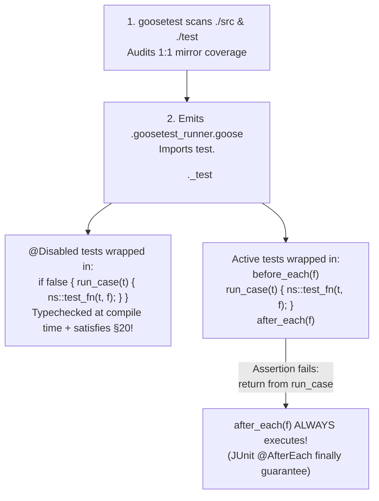

# `goosetest`: Standardized JUnit-Style Testing Framework for Goose

> **Historical prototype research, not the supported API.** See the
> [current quickstart](../README.md) and [architecture](../docs/architecture.md).
> Timing, zero-overhead, and cleanup statements below are prototype claims, not
> release guarantees. The prototypes have compressed declarations and functions
> beyond the style limits, fixed discovery capacities that silently omit inputs,
> and paths/status handling that need manual adjustment before experiments.
> In particular, the old generated program reported assertion failures while
> returning status 0. Cleanup is only attempted after recoverable framework
> failures; abort, exit, process death, and deadlines have no cleanup guarantee.
> Tags, repetitions, contained workers and the describe DSL below are unsupported.
> These files are retained as historical evidence and excluded from shipping
> source formatting and compilation checks. Their commands are not release checks.

This document presents the research, language analysis, and compiler-verified architecture for **`goosetest`**—a project-agnostic, zero-dependency, **JUnit 5-inspired** testing framework for the [Goose programming language](https://github.com/aardappel/goose) built around a strict **`./src` $\leftrightarrow$ `./test` mirrored directory tree**.

### Historical Prototypes in `poc/`

- **JUnit Mirror Scanner & Runner Generator:** [`junit_runner_poc.goose`](junit_runner_poc.goose)
- **Mirrored Example Project (`./src` + `./test`):**
  - Runtime library: [`example_project/goosetest.goose`](example_project/goosetest.goose)
  - App modules (`./src`): [`src/auth/token.goose`](example_project/src/auth/token.goose), [`src/workspaces/permissions.goose`](example_project/src/workspaces/permissions.goose), [`src/workspaces/archive.goose`](example_project/src/workspaces/archive.goose)
  - Mirrored JUnit tests (`./test`): [`test/auth/token_test.goose`](example_project/test/auth/token_test.goose), [`test/workspaces/permissions_test.goose`](example_project/test/workspaces/permissions_test.goose)
  - Historical invocation (the generator still embeds an obsolete absolute path; this is not a maintained command):
    ```bash
    goose run -O2 ~/repos/goosetest/poc/junit_runner_poc.goose && \
    goose run -O2 ~/repos/goosetest/poc/example_project/.goosetest_runner.goose
    ```
- **Contained Worker Panic/Abort Isolation PoC (`@AssertThrows` / `expect_abort`):** [`goosetest_contained_poc.goose`](goosetest_contained_poc.goose)
- **Inline RSpec/Describe-Style PoC (Alternative DSL):** [`goosetest_poc.goose`](goosetest_poc.goose)

---

## Part 1: Core Convention — Strict `./src` $\leftrightarrow$ `./test` Tree Mirroring

`goosetest` enforces a clean separation between production code and test code:
- **Application code** lives exclusively under `./src/`.
- **Test code** lives exclusively under `./test/`, mirroring the exact directory hierarchy of `./src/` with a `_test.goose` suffix:

```text
my-goose-project/
├── main.goose                           // Production entry point (imports `src.*`)
├── src/
│   ├── auth/
│   │   └── token.goose                  // namespace auth_token;
│   └── workspaces/
│       ├── permissions.goose            // namespace workspaces_permissions;
│       └── archive.goose                // namespace workspaces_archive;
└── test/
    ├── auth/
    │   └── token_test.goose             // Mirrors src/auth/token.goose
    └── workspaces/
        └── permissions_test.goose       // Mirrors src/workspaces/permissions.goose
```

### 1.1 Why This Layout Works Seamlessly with Goose's Import Rules (Spec §21)

In Goose ([`docs/reference.md` §21](file:///Users/bob/.local/share/goose/v2026.3/goose-v2026.3-macos-arm64/docs/reference.md#L3323-L3335)), `import a.b.c;` resolves `a/b/c.goose` relative to the **root file's directory** (the project root):
- Production files in `./src` import each other as `import src.auth.token;` (or relative `import .token;`).
- Mirrored test files in `./test` import their target module as `import src.auth.token;`.
- When `goosetest` runs, it generates `<project_root>/.goosetest_runner.goose` at the project root, which imports every discovered `test.<dir>.<module>_test` and executes the entire test suite in a **single whole-program compilation**.

### 1.2 Automatic Bidirectional Mirror Auditing

Because `./test` is a 1:1 mirror of `./src`, `goosetest` automatically audits project structure on every run (or as a CI gate via `goosetest --check-mirror`):
- **`[MIRROR OK]`**: `src/<path>/<name>.goose` $\leftrightarrow$ `test/<path>/<name>_test.goose`
- **`[MISSING TEST]`**: Any `src/<path>/<name>.goose` without a corresponding `test/<path>/<name>_test.goose`
- **`[ORPHAN TEST]`**: Any `test/<path>/<name>_test.goose` whose `src/<path>/<name>.goose` was moved, renamed, or deleted
- **`[NAMING WARN]`**: Any `.goose` file under `./test` that does not follow the `*_test.goose` naming convention

---

## Part 2: JUnit Elegance in Goose — Zero-Boilerplate Test Files

In JUnit 5, you never write `public static void main` or manually register test methods in a list. `goosetest` brings that exact ergonomics to Goose.

Look at [`test/auth/token_test.goose`](example_project/test/auth/token_test.goose):

```goose
import std;
import goosetest;
import src.auth.token;

namespace auth_token_test;

struct Fixture {
    admin_header: const u8[:] = "",
    teardown_count: i64 = 0,
}

fn before_each(f: Fixture&) {
    f.admin_header = "Bearer tok_admin";
}

fn after_each(f: Fixture&) {
    f.teardown_count += 1;
}

// @DisplayName("parses valid admin Bearer token into claims")
// @Tag("auth")
fn test_valid_admin_bearer(t: Test&, f: Fixture&) {
    let claims = auth_token::parse_bearer(f.admin_header);
    let expected = auth_token::TokenClaims { user_id: 1, scope: "admin", valid: true };
    t.assert_struct_eq(expected, claims, "admin token claims");
}

// @DisplayName("rejects missing or malformed Authorization header")
// @RepeatedTest(3)
fn test_malformed_header(t: Test&, f: Fixture&) {
    let claims = auth_token::parse_bearer("Basic abcdef");
    t.assert_false(claims.valid, "Basic auth should not parse as Bearer");
    t.assert_eq(0, claims.user_id, "invalid user_id must be 0");
}

// @Disabled("pending clock skew tolerance implementation in token verifier")
fn test_expired_token_clock_skew(t: Test&, f: Fixture&) {
    t.fail("not yet implemented");
}
```

### How JUnit Concepts Map to Goose Primitives

| JUnit 5 Feature | `goosetest` Equivalent | How It Works Under the Hood |
| :--- | :--- | :--- |
| **`@Test`** | `fn test_*(t: Test&, f: Fixture&)` (or `fn test_*(t: Test&)`) | Auto-discovered by `goosetest`'s scanner in `<1 ms` and wired into `.goosetest_runner.goose`. |
| **Test Instance / State** | `struct Fixture { ... }` | Optional per-suite struct; instantiated fresh on the stack before each test (`var f = ns::Fixture { .. };`) with **0 heap allocations**. |
| **`@BeforeAll` / `@AfterAll`** | `fn before_all()` / `fn after_all()` | Auto-detected per test namespace; called once before/after all `test_*` functions in that file. |
| **`@BeforeEach` / `@AfterEach`** | `fn before_each(f: Fixture&)` / `fn after_each(f: Fixture&)` | Auto-detected per test namespace; `after_each(f)` is placed **outside** `run_case(t)` so it is **guaranteed to run even when an assertion fails and unwinds**! |
| **`@DisplayName("...")`** | `// @DisplayName("...")` | Doc-comment annotation above `fn test_*`; displayed in the console tree and failure reports. |
| **`@Disabled("reason")`** | `// @Disabled("reason")` | Emitted inside `if false { run_case(t) { ... }; }` so **Goose still typechecks disabled tests at compile time** (preventing bit-rot!) while skipping them at runtime. |
| **`@RepeatedTest(N)`** | `// @RepeatedTest(N)` | Runs the `before_each` $\to$ `test_*` $\to$ `after_each` cycle $N$ times with a fresh `Fixture` each iteration. |
| **`@Tag("fast")`** | `// @Tag("fast")` | Filters suites/cases via `goosetest --tag fast` or `--exclude-tag slow`. |
| **`assertEquals(exp, act)`** | `t.assert_eq(expected, actual)` | Polymorphic equality check (`expected` first, matching JUnit convention) that formats values via Goose's `format(out, v)` and unwinds via `return from run_case`. |
| **Deep Bean/Struct Diff** | `t.assert_struct_eq(expected, actual)` | Uses `const for <N, A> in fields<T>` (Spec §16) to report every mismatched field `.field ==> expected: <...> but was: <...>`. |
| **`assertAll(...)`** | `t.check_eq(expected, actual)` | Soft assertion that records `MultipleFailuresError` into `t.log_buf` and continues executing the test. |
| **`assertThrows(...)`** | `s.expect_abort(...)` ([`goosetest_contained_poc.goose`](goosetest_contained_poc.goose)) | Spawns a contained worker (`thread_spawn_contained`, Spec §22) that catches `abort()`, `assert()`, and bounds panics in-process via `thread_wait(id, why)`. |

---

## Part 3: Three Critical Goose Compiler Insights Discovered During Prototyping

Building and compiling [`junit_runner_poc.goose`](junit_runner_poc.goose) and [`example_project/`](example_project/goosetest.goose) surfaced three subtle Goose language rules that `goosetest` handles automatically:



### 1. Why `after_each(f)` Always Runs Even Without `try/finally` in Goose
Goose's [`stdlib/exception.goose`](file:///Users/bob/.local/share/goose/v2026.3/goose-v2026.3-macos-arm64/stdlib/exception.goose#L3) notes that Goose has no `finally` keyword. However, because `return from run_case` unwinds *only* to the `run_case(t)` call frame and returns normally to its caller, placing `after_each(f)` on the line immediately following `run_case(t) { ... };` guarantees that `after_each(f)` executes whether the test passed or aborted mid-way through a deep helper call:

```goose
t.begin_case("test_valid_admin_bearer", "parses valid admin Bearer token into claims");
for rep in 1 {
    var f = auth_token_test::Fixture { .. };
    auth_token_test::before_each(f);
    run_case(t) {
        auth_token_test::test_valid_admin_bearer(t, f); // `return from run_case` lands here!
    };
    auth_token_test::after_each(f);                     // ALWAYS runs!
    if t.failed { break; }
}
t.end_case(1);
```

### 2. Why `@Disabled` Tests Must Be Wrapped in `if false { run_case(t) { ... }; }` (Spec §20)
In Goose, `return ... from run_case` is statically verified across the whole-program call graph (Spec §20). If a test function `fn test_foo(t: Test&)` calls `t.assert_eq(...)` (which contains `return from run_case`) and `test_foo` is **never called** anywhere in the program because it was `@Disabled`, Goose typechecks `test_foo` as an uncalled root function and rejects it with:
> `error: return from run_case: no enclosing call of run_case on this compile-time call path`

By emitting `if false { var f = ...; run_case(t) { ns::test_foo(t, f); }; }` before `t.skip_case(...)`:
1. `test_foo` is enclosed by `run_case(t)` in the call graph, satisfying Spec §20.
2. **Bonus:** Every `@Disabled` test is still 100% typechecked against `./src` on every test run so disabled tests never silently break when `./src` signatures change!

### 3. Why `Test` and `assert_*` Belong in the Global Namespace (Spec §11.1)
In Goose ([`docs/reference.md` §21](file:///Users/bob/.local/share/goose/v2026.3/goose-v2026.3-macos-arm64/docs/reference.md#L3382-L3384)), UFCS method syntax (`t.assert_eq(...)`) resolves in the **calling code's namespace** (e.g. `namespace auth_token_test;`) and then in the **global namespace**—it does not search a third namespace like `goosetest::`. Declaring `struct Test` and `fn assert_*(t: Test&, ...)` in the global namespace inside `goosetest.goose` (the exact pattern used by `std.goose`, `os.goose`, and `vec.goose`) allows `t.assert_eq(...)`, `t.assert_true(...)`, and `t.assert_struct_eq(...)` to work via UFCS inside every test file's namespace!

---

## Part 4: Verified End-to-End Output

Running [`junit_runner_poc.goose`](junit_runner_poc.goose) followed by the generated runner in [`example_project/.goosetest_runner.goose`](example_project/.goosetest_runner.goose) produces:

```text
═══════════════════ goosetest Mirror Audit ═════════════════════
  [MISSING TEST]   src/workspaces/archive.goose  (expected test/workspaces/archive_test.goose)
  [MIRROR OK]      src/workspaces/permissions.goose  <-->  test/workspaces/permissions_test.goose
  [MIRROR OK]      src/auth/token.goose  <-->  test/auth/token_test.goose
Mirror Coverage: 2/3 source modules have mirrored tests

┌─ workspaces_permissions_test  [src/workspaces/permissions.goose <- test/workspaces/permissions_test.goose]
│  ✓ grants write access to admin token (6 us)
│  ✗ denies write access to viewer role (intentional failure demo) (7 us)
└─ 1 passed, 1 failed, 0 skipped

┌─ auth_token_test  [src/auth/token.goose <- test/auth/token_test.goose]
│  ✓ parses valid admin Bearer token into claims (1 us)
│  ✓ rejects missing or malformed Authorization header [x3] (1 us)
│  ↷ test_expired_token_clock_skew (@Disabled: pending clock skew tolerance implementation in token verifier)
└─ 2 passed, 0 failed, 1 skipped

═══════════════════════════ Failures ═══════════════════════════
  [FAIL] workspaces_permissions_test :: test_viewer_write_denied_demo_diff ("denies write access to viewer role (intentional failure demo)")
         Source: src/workspaces/permissions.goose | Test: test/workspaces/permissions_test.goose
         AssertionFailedError: viewer write check (2 field(s) differed):
           .allowed ==> expected: <true> but was: <false>
           .reason ==> expected: <ok> but was: <insufficient_role>
═════════════════════════ JUnit Summary ════════════════════════
Suites:     2 executed
Tests:      3 passed, 1 failed, 1 skipped
Assertions: 10 checked in 0 ms
════════════════════════════════════════════════════════════════
```

---

## Part 5: Proposed `~/repos/goosetest` Repository Layout

```text
~/repos/goosetest/
├── goosetest.goose                  // Package entry: Test, assert_*, check_*, property, bench
├── contained.goose                  // Submodule (`import goosetest.contained;`): expect_abort, test_isolated
├── cmd/
│   └── goosetest.goose              // CLI tool: scans ./src & ./test, audits mirrors, emits & runs .goosetest_runner.goose
└── poc/
    ├── goosetest_framework_research.md
    ├── junit_runner_poc.goose
    ├── goosetest_poc.goose
    ├── goosetest_contained_poc.goose
    └── example_project/
        ├── goosetest.goose
        ├── src/
        │   ├── auth/token.goose
        │   └── workspaces/{permissions.goose, archive.goose}
        └── test/
            ├── auth/token_test.goose
            └── workspaces/permissions_test.goose
```
